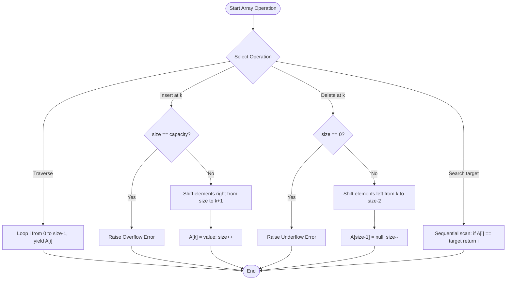

# Experiment 1: Basic Operations on Arrays

**Course:** IC-709 B – Design & Analysis of Algorithms Lab  
**Unit:** Unit 01 – Introduction to Algorithms & Performance Analysis  
**Student:** Khushi Dixit | **Roll Number:** IC-2K23-51  
**Course Outcome:** CO1  

---

## 1. Aim
To design, implement, and analyze fundamental contiguous array operations (Traversal, Insertion, Deletion, Linear Search, In-Place Update, and Reversal) with explicit bounds and capacity management.

---

## 2. Problem Statement
An array is a linear data structure that stores elements in contiguous memory locations under index-based addressing. Write a modular Python program implementing an array abstract data type (ADT) of fixed capacity supporting:
1. **Traversal:** Sequentially accessing and inspecting elements.
2. **Insertion:** Adding elements at the beginning, end, or any arbitrary index, handling element shifts and overflow.
3. **Deletion:** Removing elements by index or value, shifting remaining elements to maintain contiguous layout, and handling underflow.
4. **Search:** Sequentially scanning for a target value (Linear Search).
5. **Update:** Modifying an element at a given index in-place.
6. **Reversal:** Inverting array element order using two-pointer swapping without auxiliary array allocation.

---

## 3. Algorithm & Approach

### Insertion at Index `k`
1. Check if array size equals maximum capacity; if true, report overflow and terminate.
2. Validate index $0 \le k \le \text{size}$.
3. Shift elements from index $\text{size}-1$ down to $k$ one position to the right: $A[i] \leftarrow A[i-1]$.
4. Store the new element at $A[k]$.
5. Increment array size by 1.

### Deletion at Index `k`
1. Check if array is empty; if true, report underflow and terminate.
2. Validate index $0 \le k < \text{size}$.
3. Store $A[k]$ as the deleted element.
4. Shift elements from index $k+1$ up to $\text{size}-1$ one position to the left: $A[i-1] \leftarrow A[i]$.
5. Set the trailing position to empty and decrement size by 1.

### Array Reversal (Two-Pointer In-Place)
1. Initialize pointer `left = 0` and `right = size - 1`.
2. While `left < right`:
   - Swap $A[\text{left}]$ and $A[\text{right}]$.
   - Increment `left` by 1; decrement `right` by 1.

---

## 4. Flowchart (Mermaid)



---

## 5. Pseudocode

```text
Algorithm InsertAt(A, size, capacity, index, value):
    if size >= capacity then
        return ERROR_OVERFLOW
    if index < 0 or index > size then
        return ERROR_INDEX_OUT_OF_BOUNDS
    for i from size down to index + 1 do:
        A[i] = A[i - 1]
    A[index] = value
    size = size + 1
    return SUCCESS

Algorithm DeleteAt(A, size, index):
    if size == 0 then
        return ERROR_UNDERFLOW
    if index < 0 or index >= size then
        return ERROR_INDEX_OUT_OF_BOUNDS
    deleted_item = A[index]
    for i from index to size - 2 do:
        A[i] = A[i + 1]
    A[size - 1] = NULL
    size = size - 1
    return deleted_item
```

---

## 6. Time & Space Complexity Analysis

| Operation | Best-Case Time | Average-Case Time | Worst-Case Time | Space Complexity | Explanation |
|---|---|---|---|---|---|
| **Traversal** | $\Omega(n)$ | $\Theta(n)$ | $O(n)$ | $O(1)$ | Every element is visited once. |
| **Append (End)** | $\Omega(1)$ | $\Theta(1)$ | $O(1)$ | $O(1)$ | Direct insertion at index `size` without shifting. |
| **Insert at Index** | $\Omega(1)$ | $\Theta(n)$ | $O(n)$ | $O(1)$ | Worst case inserting at index 0 requires shifting all $n$ elements. |
| **Delete at Index** | $\Omega(1)$ | $\Theta(n)$ | $O(n)$ | $O(1)$ | Worst case deleting index 0 requires shifting $n-1$ elements left. |
| **Linear Search** | $\Omega(1)$ | $\Theta(n)$ | $O(n)$ | $O(1)$ | Best case target is at index 0; worst case target is absent. |
| **In-Place Update** | $\Omega(1)$ | $\Theta(1)$ | $O(1)$ | $O(1)$ | Direct access via index address arithmetic. |
| **In-Place Reversal** | $\Omega(n)$ | $\Theta(n)$ | $O(n)$ | $O(1)$ | Swaps $\lfloor n/2 \rfloor$ pairs using two pointers. |

---

## 7. Sample Input and Execution

### Input Configuration (in driver code)
- Initial Capacity: `10`
- Initial Elements: `[45, 12, 89, 34, 67]`
- Operations:
  - Insert `99` at index `0`
  - Insert `55` at index `3`
  - Linear search targets: `55` and `100`
  - Update index `2` to `777`
  - Delete index `0`
  - Delete value `34`
  - In-place reversal
  - Overflow test: filling beyond capacity `10`

### How to Execute
```bash
python Unit01-Introduction-Algorithms/Basic-Array-Operations/array_operations.py
```

---

## 8. Sample Execution Output

```text
======================================================================
  DESIGN AND ANALYSIS OF ALGORITHMS LAB (IC-709 B)
  Unit 01 - Experiment 1: Basic Operations on Arrays
  Student: Khushi Dixit | Roll Number: IC-2K23-51
======================================================================

[1] Initialized CustomArray with capacity = 10.
    Current Size: 0, Elements: []

[2] Appending initial elements: [45, 12, 89, 34, 67]
    Array state after append: [45, 12, 89, 34, 67] (Size: 5/10)

[3] Insertion Demonstrations:
    - Inserting 99 at index 0 (Beginning)
      State: [99, 45, 12, 89, 34, 67]
    - Inserting 55 at index 3 (Middle)
      State: [99, 45, 12, 55, 89, 34, 67]
    - Testing invalid insertion index 15 (Out of bounds)
[Error] IndexOutOfBounds: cannot insert at index 15. Valid range: [0, 7].

[4] Linear Search Demonstrations:
    - Target 55 FOUND at index 3.
    - Target 100 NOT FOUND in array.

[5] Update Operation:
    - Updating element at index 2 from 12 to 777.
      State: [99, 45, 777, 55, 89, 34, 67]

[6] Extrema Inspection:
    - Minimum value : 34
    - Maximum value : 777

[7] Deletion Demonstrations:
    - Deleting element at index 0 (99):
      Removed: 99, New State: [45, 777, 55, 89, 34, 67]
    - Deleting value 34 by search-and-remove:
      New State: [45, 777, 55, 89, 67]

[8] In-Place Array Reversal:
    - Before: [45, 777, 55, 89, 67]
    - After : [67, 89, 55, 777, 45]

[9] Boundary Edge-Case Testing (Filling to Capacity):
[Error] Array overflow: cannot insert 106, capacity (10) reached.
    Final Array State: [67, 89, 55, 777, 45, 101, 102, 103, 104, 105] (Size: 10/10)
======================================================================
  Basic Array Operations execution completed successfully.
======================================================================
```

---

## 9. Results & Observations
- Insertion at index 0 shifted all elements right, exhibiting worst-case linear time $O(n)$, while append operations ran in constant time $O(1)$.
- Deletion maintained array contiguity by left-shifting subsequent items, successfully clearing trailing allocated references.
- Array overflow and index out-of-bounds validations trapped erroneous accesses without crashing the application.
- In-place reversal completed using exactly $O(1)$ auxiliary space.

---

## 10. Learning Outcomes
- Understood contiguous memory addressing and index-to-pointer offset arithmetic.
- Learned the trade-offs of contiguous arrays: $O(1)$ random access versus $O(n)$ arbitrary insertions and deletions.
- Implemented robust defensive programming practices including bounds checking and error handling.
